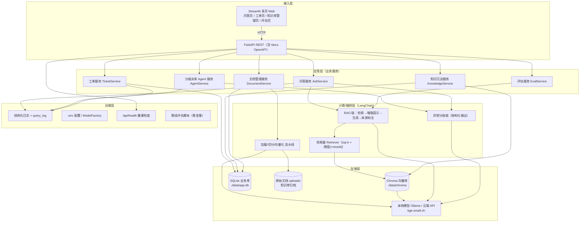
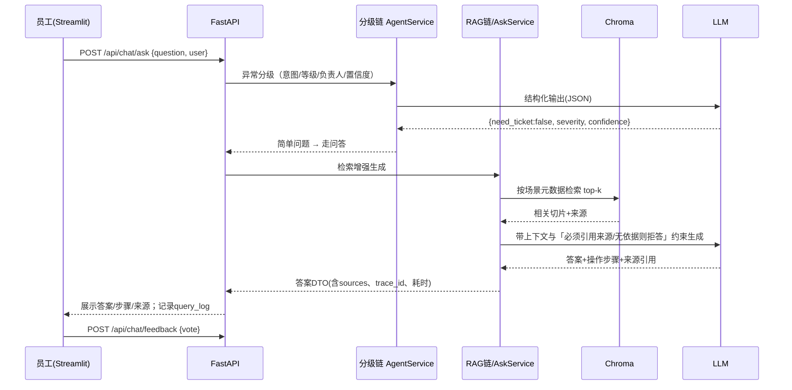
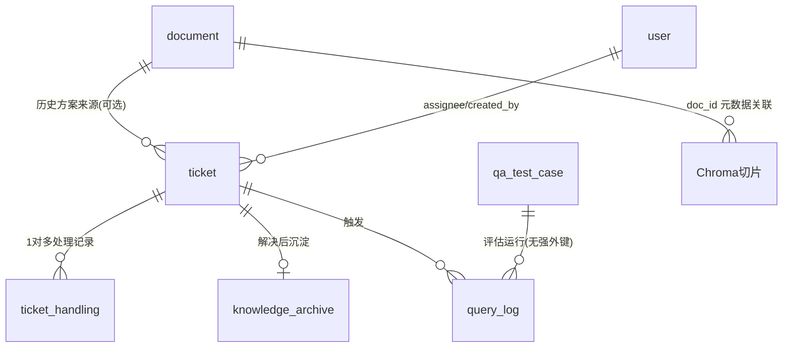

# 第一轮技术架构设计文档 · 生产异常答疑 AI 助手

> 第 2 步产物。依据《项目基线说明书》（`01_项目基线说明书.md`）设计。
> 定位：**PM 可在一台普通 Windows PC 上独立跑通的 MVP**；技术选型以「开源 LangChain 生态 + 本地优先、云端可切换 + 轻量 Agent」为准。
> 版本号均给出兼容区间，最终以 `requirements.txt` 锁定 + 第 6 步本地冒烟实测为准（LangChain 生态版本变动快，不硬编码补丁版本）。

---

## 1. 技术选型说明

### 1.1 选型总表

| 层 | 组件 | 建议版本 | 选型理由 | 备选 / 降级 |
|---|---|---|---|---|
| 语言运行时 | Python | 3.11（兼容 3.10–3.12） | RAG/LangChain 生态最成熟，PM 可独立开发 | 3.10 |
| RAG 编排 | LangChain（langchain、langchain-community、langchain-openai） | 0.3.x（langchain-openai 0.2.x） | 原始描述指定 LangChain；文档加载/切分/检索/结构化输出齐全 | 裸写 LLM 调用（不推荐） |
| LLM（本地） | Ollama + Qwen2.5-7B-Instruct（Q4 量化） | Ollama 最新稳定版 | 中文好、支持函数调用；一条命令本地部署、数据不出域 | 无 GPU 降 Qwen2.5-3B |
| LLM（云端） | OpenAI 兼容接口（DeepSeek-Chat / 通义 Qwen-Plus） | 按厂商当前 API | 效果好、速度快，保 M3 ≤ 30 秒；用 `base_url` 接入，与本地同接口 | 任意 OpenAI 兼容服务 |
| Embedding（本地） | BAAI/bge-small-zh-v1.5（经 sentence-transformers） | sentence-transformers 3.x | 中文检索强、体积小（约 100MB）、CPU 可跑 | bge-m3（更强但更重） |
| Embedding（云端） | 通义 text-embedding-v3 等 | 按厂商 API | 免本地算力 | OpenAI text-embedding |
| 向量库 | Chroma（本地持久化） | chromadb 0.5.x | 零配置、pip 安装、嵌入式、LangChain 原生集成，最契合单机 MVP | 规模化换 Qdrant（Docker） |
| 关系数据库 | SQLite + SQLAlchemy ORM | 标准库 sqlite3；SQLAlchemy 2.0.x | 单文件、零安装，承载工单/用户/沉淀/测试集 | 上量后换 PostgreSQL |
| 文档解析 | pypdf、docx2txt；可选 unstructured | pypdf 4.x/5.x | 覆盖文字版 PDF、Word 手册 | 扫描件加 OCR（pytesseract，P2） |
| 切分 | RecursiveCharacterTextSplitter（中文分隔符） | 随 langchain-text-splitters | 中文友好、参数可调（chunk≈500、overlap≈50） | 语义切分（P2） |
| 重排（可选，P1） | bge-reranker-base | sentence-transformers | 提升 top-k 命中率，保 M4 | 无 rerank 先跑 |
| 后端 API | FastAPI + Uvicorn + Pydantic v2 | fastapi 0.115.x / uvicorn 0.30.x | 自动生成 OpenAPI 文档与接口契约，便于前端 Mock 并行 | Flask |
| 前端 | Streamlit（HTTP 调 FastAPI） | streamlit 1.39.x | 纯 Python、多页面、最快出高保真可点 MVP | Gradio / 静态 HTML |
| 轻量 Agent | LLM 结构化输出（Pydantic/function calling）+ 规则路由 | 随 LangChain | 只做「分级 + 路由 + 派单」，不引入复杂多 Agent 框架，符合轻量定位 | 复杂状态机用 LangGraph（P1） |
| 鉴权 | 最简角色（Header 注入角色 / 侧边栏切换） | — | 基线已排除完整权限体系 | 预留 `Authorization` 扩展位 |
| 配置 | pydantic-settings + `.env` | 2.x | 本地/云端模型一键切换 | — |

### 1.2 关键兼容性说明

- **模型可切换**：所有 LLM/Embedding 经一个 `LLMFactory / EmbeddingFactory` 适配层创建，`.env` 中 `MODEL_PROVIDER=local|api` 切换；业务代码不直接绑定具体厂商，规避涉密与算力两类风险。
- **OpenAI 兼容**：Ollama 与主流国产 API 均暴露 OpenAI 兼容端点，统一用 `ChatOpenAI(base_url=...)`，减少分支代码。
- **Chroma 与 SQLite 共存**：向量在 Chroma，业务结构化数据在 SQLite，通过文档 `doc_id` / 知识 `archive_id` 元数据关联，不互相替代。
- **FastAPI 与 Streamlit 分离**：前端仅通过 HTTP 调后端，后端可独立用 Swagger/Mock 联调，支撑第 5 步前后端并行。

---

## 2. 整体分层架构



**各层职责：**

- **接入层**：Streamlit 承载员工、负责人、管理员三类页面；FastAPI 统一对外 REST，自动产出 OpenAPI 契约（前端据此 Mock）。
- **应用层**：六个无状态业务服务，编排下层能力，负责事务、校验与状态流转。
- **计算/编排层**：LangChain 实现「分级链」「RAG 链」「检索器」「文档入库流水线」；轻量 Agent = 分级链 + 规则路由，不做复杂多 Agent。
- **存储层**：Chroma 存向量切片，SQLite 存工单/用户/归档/测试集/日志，文件系统存原始文档，模型经适配层供给。
- **运维层**：配置集中、全链路 trace_id 日志、健康检查、可重复执行的离线评估脚本（直接产出 MVP 测试报告数据）。

---

## 3. 核心业务链路（端到端调用链）

### 3.1 链路一：简单问题 RAG 答疑（主流程）



输入：自然语言问题；处理：分级 → 检索 → 来源增强 → 受约束生成；输出：答案 + 分步操作 + 手册/历史工单号来源 + 耗时。

### 3.2 链路二：复杂问题分级派单

```mermaid
提问 → 分级链判定（复杂/高风险/低置信/安全类）
     → 生成工单（标题、问题描述、等级、负责人类型、LLM 理由、建议前置检查）
     → 入库 ticket（状态=待处理）→ 负责人在工单页看到（系统内通知；MVP 模拟推送）
     → 负责人领取(处理中) → 填写处理结果/解决步骤 → 关闭(已解决)
     → 结果回传提问员工 → 触发「知识沉淀」链路
```

**路由规则（硬规则兜底，不把安全完全交给模型）：**

- 置信度 < 阈值（默认 0.6）→ 一律生成工单（宁可不直接答）；
- 命中安全规范/高危（关键词 + 模型判断）→ 必须派单或在答案中强制「以手册为准 + 联系负责人」，不允许模型自由发挥；
- 分级负责人类型映射：设备机械/电气故障 → 维修；参数/制程/质量 → 工艺；安全 → 安全员/班组。

### 3.3 链路三：知识沉淀闭环

```mermaid
工单关闭(已解决) 或 员工点「有用」的优质问答
   → 结构化生成知识条目（问题标准问法、解决步骤、来源、场景、标签）
   → 去重校验（与现有归档/向量库算相似度，超阈值判重）
   → 写入 knowledge_archive（状态=待审核/已入库）
   → 管理员审核通过 → add_texts 进 Chroma 并标记 indexed
   → 用相似问题回归提问，验证可被检索命中（M7）
```

### 3.4 链路四：知识库入库（管理）

```mermaid
管理员上传 PDF/Word → 校验类型 → 保存 uploads
   → 解析（pypdf/docx2txt）→ 记录页码/标题
   → 中文切分(chunk=500, overlap=50) → 打元数据(doc_id/场景/设备/条款/页码)
   → bge 向量化 → 写入 Chroma；document 状态更新、chunk_count 回填
   → 抽检 3 条问答确认入库有效
```

---

## 4. 数据模型设计

### 4.1 关系库（SQLite）表结构

**document（文档表）**

| 字段 | 类型 | 说明 |
|---|---|---|
| id | INTEGER PK AUTOINCREMENT | 文档 ID |
| filename | TEXT NOT NULL | 原始文件名 |
| doc_type | TEXT | pdf / word |
| scenario | TEXT | 设备故障/工艺异常/安全规范 |
| storage_path | TEXT | uploads 相对路径 |
| chunk_count | INTEGER DEFAULT 0 | 切片数 |
| status | TEXT | uploaded/parsed/indexed/failed |
| uploaded_by | TEXT | 上传人 |
| created_at / updated_at | DATETIME | 时间戳 |

**ticket（工单表）**

| 字段 | 类型 | 说明 |
|---|---|---|
| id | TEXT PK（如 T20261019-0001） | 工单号 |
| title | TEXT NOT NULL | 标题 |
| question | TEXT NOT NULL | 原始问题 |
| route_type | TEXT | 维修 / 工艺 / 安全 |
| severity | TEXT | P0/P1/P2（紧急/较重/一般） |
| status | TEXT | 待处理/处理中/已解决/已关闭 |
| confidence | REAL | 分级置信度 |
| llm_reason | TEXT | 分级与路由理由 |
| created_by | TEXT | 提问员工 |
| assignee_role | TEXT | 负责人角色 |
| assignee | TEXT | 具体负责人（可空，领取后填） |
| answer_snapshot | TEXT | 生成时给出的参考答案快照 |
| created_at / updated_at / closed_at | DATETIME | 时间戳 |

索引：`idx_ticket_status(status)`、`idx_ticket_route(route_type, status)`、`idx_ticket_assignee(assignee, status)`。

**ticket_handling（工单处理记录表）**：id PK、ticket_id FK→ticket.id、handler TEXT、action TEXT（领取/处理/关闭）、content TEXT（处理结果与解决步骤）、created_at。索引 `(ticket_id)`。

**user（最简用户/负责人表）**：id PK、name TEXT、role TEXT（员工/维修/工艺/管理员）、is_active INTEGER DEFAULT 1。

**knowledge_archive（沉淀知识表）**：id PK、standard_question TEXT、solution TEXT、scenario TEXT、tags TEXT、source_ticket_id TEXT NULL、source_doc TEXT、status TEXT（待审核/已入库/驳回）、indexed INTEGER DEFAULT 0、similarity_key TEXT（去重指纹）、created_at。索引 `(status, indexed)`、`(scenario)`。

**feedback（问答反馈表）**：id PK、trace_id TEXT、question TEXT、vote TEXT（up/down）、comment TEXT、created_at。索引 `(vote)`。

**qa_test_case（黄金测试集）**：id PK、scenario TEXT、question TEXT、standard_answer TEXT、source_ref TEXT、expected_route TEXT（answer/ticket）、severity TEXT。

**query_log（问答链路日志表）**：id PK、trace_id TEXT、question TEXT、route_result TEXT、severity TEXT、confidence REAL、retrieve_ms INTEGER、generate_ms INTEGER、total_ms INTEGER、model TEXT、retrieved_docs TEXT、need_ticket INTEGER、ticket_id TEXT NULL、created_at。索引 `(trace_id)`、`(created_at)`。

### 4.2 向量库（Chroma）

- collection：`factory_kb`；
- 每片字段：`id`、`embedding`（bge-small-zh，512 维）、`document`（切片文本）、`metadata`：
  `doc_id, doc_name, section, page, scenario, device_type, source_type(手册/历史工单/归档知识), ref_id`；
- 文档切片由入库流水线写入；归档知识审核后以 `source_type=归档知识`、`ref_id=archive_id` 追加，与手册切片同库检索。

### 4.3 表关联关系



---

## 5. 接口规范定义

### 5.1 统一约定

- 基址：`http://127.0.0.1:8000/api`；
- 统一返回包：

```json
{ "code": 0, "message": "ok", "data": { }, "trace_id": "tr-xxxx" }
```

- 分页：`?page=1&page_size=20`，返回 `data: {list, total, page, page_size}`；
- 鉴权（MVP）：请求头 `X-User-Name`、`X-User-Role` 注入当前用户与角色；预留 `Authorization` 扩展位，不做真 JWT。
- 时间统一 ISO 8601（UTC+8）；文本编码 UTF-8。

### 5.2 错误码规范

| 区间 | 含义 |
|---|---|
| 0 | 成功 |
| 1000–1999 | 参数/校验错误（1001 参数缺失、1002 类型不支持、1003 文件过大） |
| 2000–2999 | 知识库/检索错误（2001 知识库为空、2002 无足够相关内容→触发兜底/拒答） |
| 3000–3999 | 模型/Agent 错误（3001 模型不可用、3002 结构化输出解析失败、3003 超时） |
| 4000–4999 | 工单/业务错误（4001 工单不存在、4002 状态流转非法） |
| 5000–5999 | 系统/依赖错误（5001 内部错误、5003 下游服务不可用） |

### 5.3 核心接口清单

| 方法 | 路径 | 入参（要点） | 返回 data（要点） |
|---|---|---|---|
| POST | `/chat/ask` | question, scenario?(可选过滤), user | route(answer/ticket), answer, steps[], sources[], confidence, need_ticket, ticket_id?, trace_id, total_ms |
| POST | `/chat/feedback` | trace_id, vote(up/down), comment? | 结果 |
| GET | `/tickets` | status?, route_type?, page | 工单分页列表 |
| POST | `/tickets` | question, route_type, severity, reason（自动/手动建单） | ticket |
| GET | `/tickets/{id}` | id | 工单详情 + 处理记录 |
| POST | `/tickets/{id}/assign` | assignee | 工单（状态→处理中） |
| POST | `/tickets/{id}/handle` | content（解决步骤） | 工单（追加处理记录） |
| POST | `/tickets/{id}/close` | 是否归档 `archive=true` | 工单（已关闭）+ archive_id |
| GET | `/knowledge/archives` | status?, scenario? | 沉淀条目分页 |
| POST | `/knowledge/archives/{id}/review` | approve(bool) | 审核通过则入库并 indexed=1 |
| POST | `/documents/upload` | multipart 文件 + scenario | document 元数据（触发异步入库） |
| GET | `/documents` | — | 文档列表与状态 |
| POST | `/documents/{id}/rebuild` | id | 重建索引任务结果 |
| GET | `/health` | — | 模型/向量库/数据库连通状态 |
| POST | `/eval/run`（脚本调用为主） | 场景/条数 | 准确率、召回、平均时延、派单正确率 |

> 第 5 步后端需为以上接口提供 Mock 返回（尤其 `/chat/ask`、工单系列），前端据此并行开发。

---

## 6. 部署架构设计

### 6.1 单机本地部署（MVP 主路径）

```mermaid
flow LR
    subgraph PC["一台普通 Windows PC"]
        ENV[".env 配置<br/>MODEL_PROVIDER=local|api"]
        BE["FastAPI(Uvicorn) :8000"]
        FE["Streamlit :8501"]
        DATA["./data: chroma/ app.db uploads/"]
        OL["Ollama :11434（本地模式）"]
    end
    FE -->|HTTP| BE
    BE --> DATA
    BE -.本地模式.-> OL
    BE -.云端模式.-> CLOUD["OpenAI兼容API（DeepSeek/通义）"]
```

- 启动：`python -m venv .venv` → `pip install -r requirements.txt` → 配置 `.env` → `uvicorn app.main:app --port 8000` → `streamlit run frontend/app.py --server.port 8501`。
- 全离线栈：Ollama + bge-small-zh + Chroma，满足涉密资料不出域。
- 云端兜底：`.env` 切 `MODEL_PROVIDER=api` 并填 key，用于本地模型时延/效果不达标时保 M3/M4。

### 6.2 环境划分

- `.env.dev`（本地调试，默认）、`.env.eval`（离线评估，固定模型与温度=0）；MVP 不单设生产环境。

### 6.3 高可用 / 弹性（MVP 降级说明）

- 基线明确不做生产级高可用与扩缩容；仅做：模型超时重试 1 次 + 降级规则（结构化输出失败→走规则兜底；检索无结果→拒答并提示派单）、Chroma/SQLite 定期备份 `./data`。
- 预留上量演进路径：Chroma→Qdrant、SQLite→PostgreSQL、Streamlit→前后端分离 SPA、Ollama→统一推理服务。

---

## 7. 监控与运维

- **结构化日志**：统一 logging，按 `trace_id` 串联一次问答；关键事件落 SQLite `query_log`（分级结果、置信度、检索/生成耗时、模型、命中文档、是否派单、工单号）。
- **核心监控指标**：问答量、平均/分位响应时延（直接支撑 M3）、派单占比、反馈点踩率、检索空结果率（2002）、模型失败率（3001/3003）。
- **安全/幻觉告警**：安全类问题若答案无来源 → 拦截并记为异常，强制拒答+派单；`temperature=0` 用于评估。
- **健康检查**：`/api/health` 探测 DB、Chroma、LLM 连通性。
- **离线评估流水线**：`eval/run_eval.py` 批量跑黄金测试集，输出准确率（M4）、派单正确率（M5）、召回、P50/P95 时延（M3），一键生成 MVP 测试报告所需数据。
- **运维手册**：依赖安装、`./data` 备份与恢复、索引重建、切换模型、常见启动报错处理（第 10 步交付）。

---

## 8. 技术风险与应对方案

| # | 风险 | 影响 | 等级 | 应对 |
|---|---|---|---|---|
| R1 | 普通 PC 跑本地 7B 模型慢，M3 ≤ 30 秒不达标 | 体验/指标 | 高 | 模型可切换；CPU 降 3B/Q4；不达标切云端 API 并在报告中如实对比 |
| R2 | 模型幻觉，安全规范乱答 | 合规/安全 | 高 | 强制 RAG 引用来源；无相关内容(2002)即拒答；安全类强制手册依据 + 提示联系负责人；低置信转派单 |
| R3 | 中文手册切分/检索召回低，M4 不达标 | 准确率 | 高 | bge-small-zh + 中文切分调参；元数据按场景过滤；P1 加 bge-reranker |
| R4 | 扫描件/图片版 PDF 无法解析 | 资料无法入库 | 中 | 第 6 步先确认手册格式；文字版 pypdf；扫描件 OCR 列为 P2，必要时用文字版手册替代 |
| R5 | 分级误判（该派单没派、路由错人） | 业务正确性 | 中 | 置信度阈值 + 硬规则兜底 + 安全类强制人工；M5 测试集回归；阈值可配置 |
| R6 | LangChain/Chroma 版本更新快、接口变动 | 跑不起来 | 中 | 工厂适配层封装；`requirements.txt` 锁定；第 6 步冒烟真实安装验证 |
| R7 | 沉淀知识重复/噪声污染知识库 | 答案质量 | 中 | 入库前去重（相似度阈值）；管理员审核后才 `indexed=1` |
| R8 | 云端 API 导致涉密资料出域 | 合规 | 中 | 默认本地栈；`.env` 显式开关；切云端时 UI 提示；涉密手册强制本地模式 |
| R9 | Streamlit 对复杂工单交互支持有限 | 演示效果 | 低 | 用多页 + 表单/状态按钮满足 MVP；不足时 P2 替换前端，后端契约不变 |
| R10 | 黄金测试集规模小导致 85% 可信度不足 | 评估可信度 | 低 | 覆盖 3 类场景均衡取样，每类不少于 15 条；报告给置信区间与混淆案例 |

---

## 9. 模块与代码目录建议（供第 4/5 步拆解）

```
生产异常答疑AI助手/
├── app/                     # FastAPI 后端
│   ├── main.py              # 入口、路由注册、健康检查
│   ├── core/                # 配置、日志、ModelFactory、异常
│   ├── api/                 # chat / tickets / knowledge / documents / eval 路由
│   ├── schemas/             # Pydantic 请求/响应模型（即接口契约）
│   ├── services/            # ask / agent / ticket / knowledge / document / eval
│   ├── rag/                 # loaders、splitter、retriever、chains、prompts
│   ├── models/              # SQLAlchemy ORM
│   └── db/                  # engine、session、init_db
├── frontend/                # Streamlit
│   ├── app.py               # 多页入口（问答/工单/知识库/评估）
│   └── pages/
├── data/                    # chroma/ app.db uploads/（运行时生成）
├── eval/                    # 黄金集 run_eval.py、测试报告
├── docs/                    # 需求、流程、原型、部署运维手册
├── requirements.txt
├── .env.example
└── README.md
```

---

**结论**：该架构在单台普通 PC 上可完整实现基线核心范围（S1–S8），本地优先兼顾涉密合规，云端可切换保性能指标；R1/R2/R3 为高优先风险，需在第 3 步评审重点确认，且其应对措施已在架构中预留。
