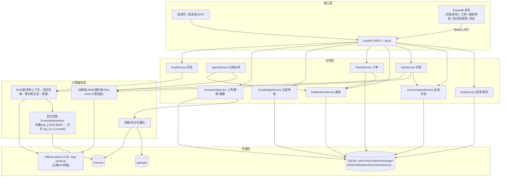
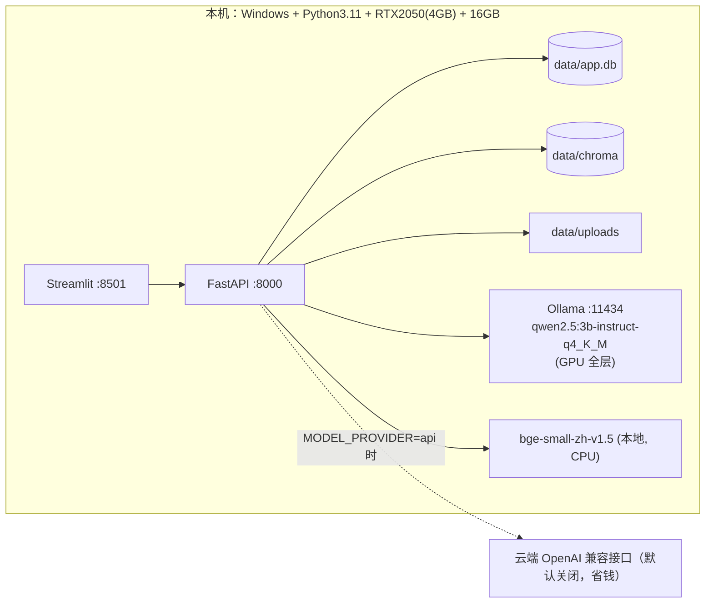

# 第二轮技术架构设计文档（定稿）· 生产异常答疑 AI 助手

> 第 3 步产物（3.2 定稿）。在《第一轮技术架构设计文档》基础上，落实第一轮评审的 P1 改进，并纳入人工复核确认的 4 个新增模块（登录、多轮追问、文档删除、负责人通知）与本地模型方案。
> 评审日期：2026-10-19。本机环境：Windows + Python 3.11.9 + RTX 2050（4GB 显存）+ 16GB 内存。**原则：省钱优先、本地优先。**

## 0. 相对第一轮的变更摘要

| 编号 | 变更 | 来源 |
|---|---|---|
| C1 | 模型默认路径锁定为**本地 Ollama + Qwen2.5-3B-Instruct(Q4)** + bge-small-zh，零 API 成本；云端 API 仅作不达标兜底，且 Key/base_url 由用户在 `.env` 配置 | P1-1 + 用户环境/省钱诉求 |
| C2 | 分级链明确「不依赖 function calling」的 JSON 强约束 + 校验 + 三级兜底 + few-shot | P1-2 |
| C3 | 派单触达明确为**系统内通知（未读角标/自动刷新）**，新增通知模块与接口 | P1-3 + 用户新增 |
| C4 | 检索升级为**元数据过滤 + 向量/BM25 混合检索**（核心），rerank 为可选精排 | P1-4 |
| C5 | 评估脚本分「检索命中/答案命中/路由正确」两层三指标 + 归因桶 + 初始参数 | P1-5 |
| C6 | 新增**登录认证与角色权限**（JWT + 密码哈希 + 五类角色守卫） | 用户新增（基线核心范围第 7 项） |
| C7 | 新增**多轮会话**：conversation/message 表、历史上下文、会话接口 | 用户新增（基线核心范围第 8 项） |
| C8 | 新增**文档删除**接口（同步删 Chroma 向量） | 用户新增（P2-6 提升） |

---

## 1. 技术选型说明（定稿）

| 层 | 组件 | 版本/规格 | 说明 |
|---|---|---|---|
| 运行时 | Python | 3.11.9（用户已装，兼容 3.10–3.12） | — |
| RAG | langchain、langchain-community、langchain-text-splitters、langchain-openai | 0.3.x | 文档处理/链/混合检索/OpenAI 兼容接入 |
| **本地 LLM（默认）** | **Ollama + Qwen2.5-3B-Instruct（q4_K_M，约 2GB）** | Ollama 最新稳定 | 4GB 显存可全层加载，零成本；中文与指令跟随可满足 RAG |
| 本地 LLM（备选） | Qwen2.5-7B-Instruct(Q4，约 4.4GB) | 部分层 offload 共享内存 | 3B 准确率不足时做基准对比，速度较慢 |
| 云端 LLM（兜底） | OpenAI 兼容接口（待用户给服务商与 base_url） | `.env` 配置 | 仅当本地不达标时启用，省钱优先默认关闭 |
| 本地 Embedding | BAAI/bge-small-zh-v1.5（约 100MB，默认 CPU） | sentence-transformers 3.x | 中文强、CPU 可跑 |
| 向量库 | Chroma 持久化 | chromadb 0.5.x | 元数据过滤 + 向量检索 |
| 关键词检索 | BM25Retriever（langchain，rank_bm25） | 随 community | 对设备型号/故障代码做精确/词面召回 |
| 混合检索 | EnsembleRetriever（向量+BM25 加权） | 随 langchain | 见 §5 |
| 重排（可选） | bge-reranker-base | 约 0.4GB，默认关闭 | 与 LLM 共享显存紧张，CPU 跑或按需开 |
| 关系库 | SQLite + SQLAlchemy | SQLAlchemy 2.0.x | 单文件 app.db |
| 认证 | python-jose（JWT）+ passlib[bcrypt] | python-jose 3.x / passlib 1.7 | 登录态与密码哈希 |
| 后端 | FastAPI + Uvicorn + Pydantic v2 | fastapi 0.115.x / uvicorn 0.30.x | 自动 OpenAPI 契约 |
| 前端 | Streamlit（多页 + HTTP 调后端） | streamlit 1.39.x | 登录页/问答/工单/通知/知识库/评估 |
| 通知刷新 | streamlit-autorefresh（或手动刷新按钮兜底） | 轻量 | 未读角标 |
| 文档解析 | pypdf、docx2txt | pypdf 4.x/5.x | 文字版 PDF/Word；扫描件 OCR 列 P2 |

**兼容性**：Ollama 暴露 OpenAI 兼容端点（`/v1`），与云端统一经 `ChatOpenAI(base_url=...)` + `ModelFactory` 适配；Chroma 支持 `delete(where={"doc_id": ...})` 满足 C8；JWT 依赖与业务解耦，未带 Token 仅可访问 `/auth/login`。

---

## 2. 整体分层架构（定稿）



新增/调整服务：`AuthService`（登录校验、JWT、角色守卫）、`ConversationService`（会话与消息、上下文拼装）、`NotificationService`（生成/查询/已读通知）；`DocumentService` 增加删除并清理向量。

---

## 3. 核心业务链路（定稿）

### 3.0 登录与权限
```
用户在登录页输入用户名密码 → POST /auth/login → 校验 bcrypt 哈希
  → 签发 JWT（含 user_id、role、过期时间）→ 前端存 session_state，后续请求带 Bearer
  → 后端按角色守卫放行：员工=问答/自己的工单；维修/工艺=对应 route 工单领取处理；安全=安全工单；管理员=用户/文档/知识审核/评估
```

### 3.1 多轮 RAG 问答（含简单/复杂分流）
```
员工提问（携带 conversation_id，可为空）
  → 取该会话最近 6 条消息作为上下文
  → 分级链判定（结合上下文理解追问）：
       简单 → 混合检索（可按场景过滤）→ 取 top_k 片段
             → 受约束生成（中文、分步、必须引用来源、无依据则拒答，温度低）
             → 写 message(user/assistant)、写 query_log → 返回答案/步骤/来源
       复杂/高风险/低置信 → 生成工单 → 按角色创建系统内通知 → 写消息（含 ticket_id）
  → 前端可继续追问（同 conversation_id）
```

### 3.2 分级派单 + 通知
```
分级链输出 JSON：{need_ticket, severity(P0/P1/P2), route_type(维修/工艺/安全), confidence, reason}
  → 硬规则兜底：置信度<0.6 或安全类或解析失败 → need_ticket=true
  → 建 ticket（待处理）→ 按 route_type 查该角色活跃用户 → 批量写 notification
  → 负责人登录后导航栏未读角标 + 自动刷新看到待处理工单
  → 领取（处理中，通知指派）→ 填写处理结果 → 关闭（已解决，可勾选沉淀）
```

### 3.3 知识沉淀
```
工单关闭(勾选沉淀) 或优质问答 → 生成知识条目 → 相似度去重 → knowledge_archive(待审核)
  → 管理员审核通过 → add_texts 进 Chroma(source_type=归档知识) → indexed=1
  → 用相似问题回归验证可召回（M7）
```

### 3.4 文档上传/删除/重建
```
上传：管理员上传 PDF/Word → 解析 → 中文切分(chunk≈500/overlap≈50) → 打元数据 → bge 向量化 → Chroma
删除：DELETE /documents/{id}（仅管理员）→ 删 uploads 文件 + Chroma(where doc_id) + SQLite 记录
重建：删旧向量 → 重新切分入库
```

---

## 4. 数据模型设计（定稿，含新增/变更）

> 仅列新增与关键变更；其余表（document、knowledge_archive、feedback、qa_test_case、query_log）沿用第一轮，query_log 增加 `conversation_id`、`user_id`。

### 4.1 user（变更：账号化）
| 字段 | 类型 | 说明 |
|---|---|---|
| id | INTEGER PK | |
| username | TEXT UNIQUE NOT NULL | 登录账号 |
| password_hash | TEXT NOT NULL | bcrypt 哈希 |
| display_name | TEXT | 姓名 |
| role | TEXT NOT NULL | employee/repair/process/safety/admin |
| is_active | INTEGER DEFAULT 1 | |
| created_at | DATETIME | |

### 4.2 conversation（新）
| 字段 | 类型 | 说明 |
|---|---|---|
| id | INTEGER PK | |
| title | TEXT | 会话标题（取首问前 20 字） |
| user_id | INTEGER FK→user.id | 归属员工 |
| created_at / updated_at | DATETIME | |

索引：`(user_id, updated_at)`。

### 4.3 message（新）
| 字段 | 类型 | 说明 |
|---|---|---|
| id | INTEGER PK | |
| conversation_id | INTEGER FK→conversation.id | |
| role | TEXT | user / assistant |
| content | TEXT | 文本 |
| sources | TEXT(JSON) | 引用来源快照 |
| route_result | TEXT | answer/ticket |
| ticket_id | TEXT NULL | 关联工单 |
| created_at | DATETIME | |

索引：`(conversation_id, created_at)`。

### 4.4 notification（新）
| 字段 | 类型 | 说明 |
|---|---|---|
| id | INTEGER PK | |
| user_id | INTEGER FK→user.id | 接收负责人 |
| type | TEXT | ticket_assign / ticket_status / system |
| title | TEXT | |
| content | TEXT | |
| ref_type | TEXT | 固定 ticket |
| ref_id | TEXT | 工单号 |
| is_read | INTEGER DEFAULT 0 | |
| created_at | DATETIME | |

索引：`(user_id, is_read)`、`(user_id, created_at)`。

### 4.5 ticket（关键变更）
保留全部原字段；新增/明确：`created_by_user_id INTEGER FK→user.id`；`assignee` 可空（按角色先派单，具体人领取后回填）；`route_type` 增加 `安全`。

### 4.6 权限与路由
- route_type 映射：设备/机械/电气 → `repair`；参数/制程/质量 → `process`；安全规范/高危 → `safety`；无法判定 → `admin`（人工再分流）。
- 通知按角色广播：如 repair 工单通知所有 `role=repair AND is_active=1` 的用户，任一人领取后置为 `assignee` 并可通知同组"已被领取"。

### 4.7 Chroma 元数据（定稿）
`doc_id, doc_name, section, page, scenario, device_type, source_type(手册/归档知识), ref_id`；删除文档按 `doc_id` 精确清理；检索默认返回 `documents + metadatas + distances`。

---

## 5. 检索、分级与生成（定稿，P1 落地）

### 5.1 混合检索（C4）
- 向量路：Chroma 相似度检索 `k=8`，支持 `scenario` 元数据过滤；
- 关键词路：BM25Retriever 对全量切片建词面索引，重命中设备型号、故障代码；
- 合并：`EnsembleRetriever`（初始权重 向量 0.6 / BM25 0.4）→ 合并去重后取 `k=4`；
- 相关阈值：`similarity/distance` 低于阈值（初始相似度 0.35，按实际距离标度在评估中校准）视为无相关内容；
- 可选精排：开启 bge-reranker 后取 top3（默认关闭，显存紧张时 CPU 跑）。

### 5.2 分级链（C2）
- Prompt 强制输出 JSON schema + 5–8 个中文 few-shot（含简单直答、设备故障派维修、工艺参数派工艺、安全问题派安全、模糊不清转派单）；
- 输出经 Pydantic 校验；三级兜底：①重试 1 次 → ②正则截取首个 `{...}` 再校验 → ③仍失败则 `need_ticket=true, route_type=admin`；
- 安全类用关键词规则前置，不依赖模型自觉。

### 5.3 生成约束
- 系统提示词：仅依据给定片段作答；按「结论 + 分步操作 + 来源」组织；无相关内容必须明确"手册中未找到，已为你转派/请联系负责人"，禁止编造；安全类追加"以手册为准，必要时停止作业并联系负责人"；
- 评估时 `temperature=0`；对话问答可 0.1。

### 5.4 评估闭环（C5）
- `eval/run_eval.py` 对黄金集（≥50 条、三类均衡、每类 ≥15）逐条统计：
  - `retrieval_hit@k`：标准来源是否进召回（检索层）；
  - `answer_correct`：人工按「直接可用/部分可用/错误」判定（生成层）；
  - `route_correct`：answer/ticket 与 expected_route 是否一致；
  - 时延：retrieve_ms / generate_ms / total_ms 的 P50/P95。
- 失败归因桶：没召回 / 召回但答错 / 分级错 / 超时；据此调 chunk、k、权重、阈值、是否开 rerank，每次改动留档。

---

## 6. 接口规范（定稿，列新增/变更）

统一返回 `{code,message,data,trace_id}`，错误码沿用第一轮（1000 参数 / 2000 检索 / 3000 模型 / 4000 工单 / 5000 系统；新增 401 未认证、403 无权限、404 不存在）。除登录外均需 `Authorization: Bearer <token>`。

| 方法 | 路径 | 权限 | 说明 |
|---|---|---|---|
| POST | `/auth/login` | 公开 | 入参 username/password；返回 access_token 与用户信息 |
| POST | `/auth/logout` | 登录 | 前端丢弃 Token（服务端可留空实现） |
| GET | `/auth/me` | 登录 | 当前用户 |
| POST | `/users` | admin | 新建用户（初始种子脚本另建默认账号） |
| GET | `/users` | admin | 用户列表/停用 |
| POST | `/chat/ask` | 登录 | 增加 `conversation_id`（可空）；返回 conversation_id、answer、steps、sources、route、need_ticket、ticket_id、trace_id、total_ms |
| GET | `/conversations` | 登录 | 我的会话列表 |
| POST | `/conversations` | 登录 | 新建会话 |
| GET | `/conversations/{id}/messages` | 登录 | 历史消息（仅本人） |
| DELETE | `/conversations/{id}` | 登录 | 删除自己的会话（P2 可后置） |
| GET | `/notifications` | 登录 | 我的通知 + unread_count |
| POST | `/notifications/{id}/read` | 登录 | 标记已读 |
| POST | `/notifications/read-all` | 登录 | 全部已读 |
| POST | `/tickets` | 登录 | 自动/手动建单；自动写通知 |
| GET | `/tickets` | 登录 | 按角色/状态过滤 |
| POST | `/tickets/{id}/assign` | 负责人/admin | 指派并通知 |
| POST | `/tickets/{id}/handle` | 负责人/admin | 提交处理结果 |
| POST | `/tickets/{id}/close` | 负责人/admin | 关闭；`archive=true` 则进沉淀 |
| POST | `/documents/upload` | admin | 上传并异步入库 |
| GET | `/documents` | 登录 | 列表 |
| **DELETE** | **`/documents/{id}`** | **admin** | **删文件 + 删向量 + 删记录（C8）** |
| POST | `/documents/{id}/rebuild` | admin | 重建索引 |
| GET | `/knowledge/archives` | 登录 | 列表 |
| POST | `/knowledge/archives/{id}/review` | admin | 审核通过则入库 |
| GET | `/health` | 公开 | DB/Chroma/LLM 连通 |
| POST | `/eval/run` | admin | 跑黄金集，输出指标 |

> 第 5 步后端须对 `/auth/login`、`/chat/ask`、工单系列、通知系列给出 Mock，前端基于 Mock 并行。

---

## 7. 部署架构（定稿，本地省钱优先）



- **准备**：`ollama pull qwen2.5:3b-instruct-q4_K_M`；首次运行自动下载 bge-small-zh（可预置离线目录）；
- **初始化**：`python scripts/init_db.py` 建表并写入默认账号（admin/admin123 等，首次登录提示修改）；
- **启动**：`uvicorn app.main:app --port 8000` 与 `streamlit run frontend/app.py --server.port 8501`；
- **`.env`（`.env.example` 占位，真实值不入库，`.gitignore` 必须含 `.env`、`data/`）**：
  ```
  MODEL_PROVIDER=local
  LOCAL_BASE_URL=http://127.0.0.1:11434/v1
  LOCAL_MODEL=qwen2.5:3b-instruct-q4_K_M
  EMBEDDING_PROVIDER=local
  EMBEDDING_MODEL=BAAI/bge-small-zh-v1.5
  CHROMA_DIR=./data/chroma
  DATABASE_URL=sqlite:///./data/app.db
  JWT_SECRET=change-me-in-local
  # 兜底（留空即关闭）：
  API_BASE_URL=
  API_KEY=
  API_MODEL=
  ```
- **第 6 步冒烟基准**：固定 5 条问题，对比 3B 本地 / 7B 部分 offload / 云端 三档的时延与答质，结合 M3/M4 决定默认（省钱优先 3B）。
- 高可用沿用第一轮：MVP 不做，仅做超时重试与降级；备份 `data/`。

---

## 8. 监控运维与风险（定稿）

- 监控：query_log 增加 user_id/conversation_id；关注 401/403、检索空结果率、通知送达数、分级失败降级率、各模型时延。
- 评估报告：直接由 `eval/run` 输出，供 M3/M4/M5/M7 填写。

**更新后的主要风险：**

| # | 风险 | 等级 | 应对 |
|---|---|---|---|
| R1 | 3B 模型在 4GB 显存上答质/分级不及 7B，M4 可能不达 85% | 高 | 冒烟三档基准；RAG 强检索+few-shot 补 3B；不达标先开 rerank/调 prompt，仍不行再用云端兜底 |
| R2 | 幻觉/安全问题乱答 | 高 | 来源强约束、无依据拒答、安全前置派单 |
| R3 | BM25 对中文需分词，专有名词切词不当影响召回 | 中 | 切片保留故障代码/型号原文；BM25 配中文友好切词（jieba 分词），按评估调 |
| R4 | 扫描件无法解析 | 中 | 默认文字版；OCR 列 P2 |
| R5 | LLM 与 bge 同时占 GPU/内存导致 4GB 显存紧张 | 中 | bge 默认 CPU；只在需要时加载模型；控制并发=1 |
| R6 | 版本变动 | 中 | requirements 锁定 + 冒烟实测 |
| R7 | 沉淀重复污染 | 中 | 去重 + 人工审核 |
| R8 | 云端 Key 出域/泄露 | 中 | 默认关闭；真实 Key 仅放 `.env` 且不入库；用户已在对话暴露 Key，建议重置 |
| R9 | Streamlit 多页与登录态/通知刷新体验 | 低 | session_state 管登录态；autorefresh 或手动刷新 |
| R10 | JWT 密钥管理 | 低 | MVP 本地密钥，写入 `.env`，不硬编码 |

---

## 9. 代码目录（定稿）

```
生产异常答疑AI助手/
├── app/
│   ├── main.py
│   ├── core/{config.py, logging.py, security.py, model_factory.py, deps.py}
│   ├── api/{auth.py, chat.py, conversations.py, notifications.py, tickets.py,
│   │        documents.py, knowledge.py, users.py, eval.py, health.py}
│   ├── schemas/            # 请求/响应/分级JSON的Pydantic模型
│   ├── services/{auth,conversation,ask,agent,notification,ticket,knowledge,document,eval}_service.py
│   ├── rag/{loaders.py, splitter.py, retriever.py(混合), chains.py, prompts.py, grading.py}
│   ├── models/             # SQLAlchemy：user/conversation/message/notification/ticket/...
│   └── db/{engine.py, session.py, init_db.py}
├── frontend/{app.py, pages/{登录,问答,工单,通知,知识库,评估}.py, api_client.py}
├── scripts/{init_db.py, seed_data.py}
├── eval/{dataset/黄金集.jsonl, run_eval.py, 测试报告模板.md}
├── data/{chroma,app.db,uploads}   # 运行时，.gitignore
├── docs/{需求文档,业务流程图,高保真原型,部署运维手册}
├── requirements.txt
├── .env.example
├── .gitignore
└── README.md
```

---

**定稿结论**：本版完整覆盖基线核心范围第 1–8 项（含人工新增的登录、多轮、通知、文档删除），在 4GB 显存、16GB 内存、省钱约束下以本地 3B 为主、云端兜底，落地路径清晰；接受第二轮复审（仅核验第一轮 P1 落实与新增模块完整性）。
